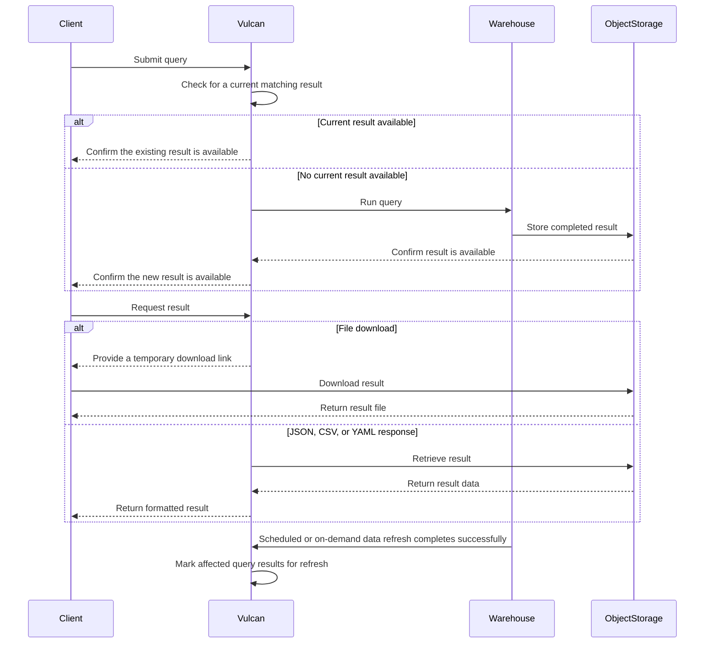

# Query Result Caching

Vulcan reuses the result of an identical query when its underlying data is still current. This provides faster responses and avoids repeating unnecessary warehouse work.

## When results are reused

Result reuse is available for all supported query experiences:

- SQL queries
- Semantic queries, including REST, SQL, and GraphQL requests
- Metric queries
- Saved perspective refreshes

Vulcan can return a previously computed result when a new request matches the earlier request in all of the following ways:

- **Query definition:** the same SQL, semantic query, or metric query.
- **Query inputs:** the same filters, parameters, dimensions, date range, sorting, and pagination settings.
- **Execution context:** the same selected data source.

The response indicates that the existing result was reused and includes when it was originally computed.

If an identical query is already running, Vulcan joins that in-progress request instead of starting duplicate work. The result is available once the original request finishes.

## Keeping results current

Vulcan tracks the data products used by each query result. When a successful data refresh updates any of those dependencies, affected results are no longer reused. The next request runs again and produces a fresh result.

For externally managed data sources, Vulcan also respects their configured refresh schedule. A result is refreshed after the source reaches its next scheduled refresh boundary.

## How result reuse works

## Receiving query results

Vulcan stores completed query results in your configured cloud object storage. This allows large results to be delivered efficiently while keeping the query experience consistent across supported storage providers.

For a result-file download, Vulcan provides a temporary download link and your client retrieves the file directly from cloud object storage. For JSON, CSV, or YAML responses, Vulcan retrieves the result and returns it in the requested format.

## What to expect

- Reused results are returned more quickly than a new warehouse execution.
- Results remain reusable only while their dependent data is current.
- A successful refresh of relevant data automatically makes the next matching query run again.
- Each query request remains traceable, including requests that reuse an existing result.
